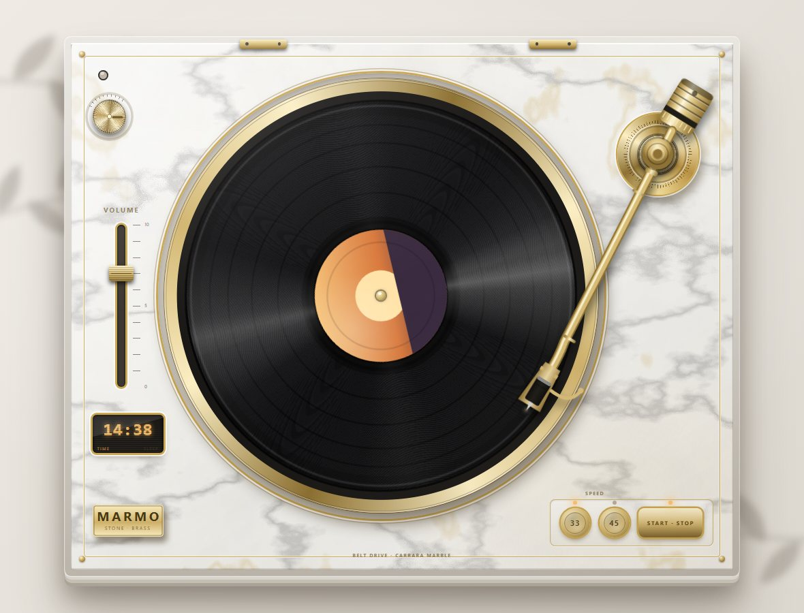
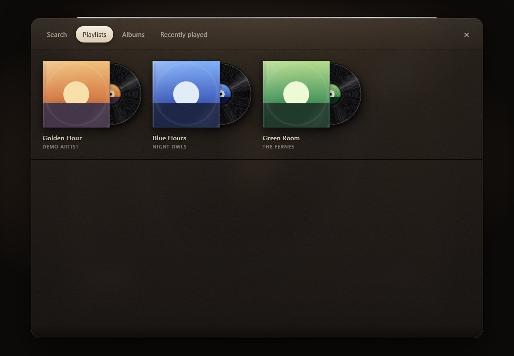
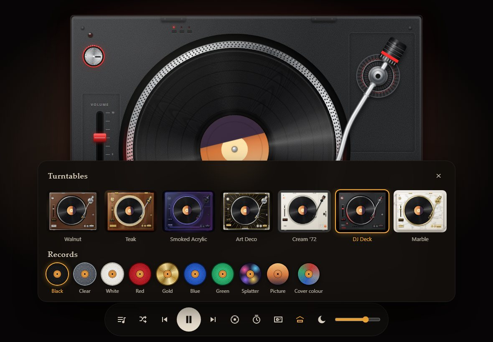
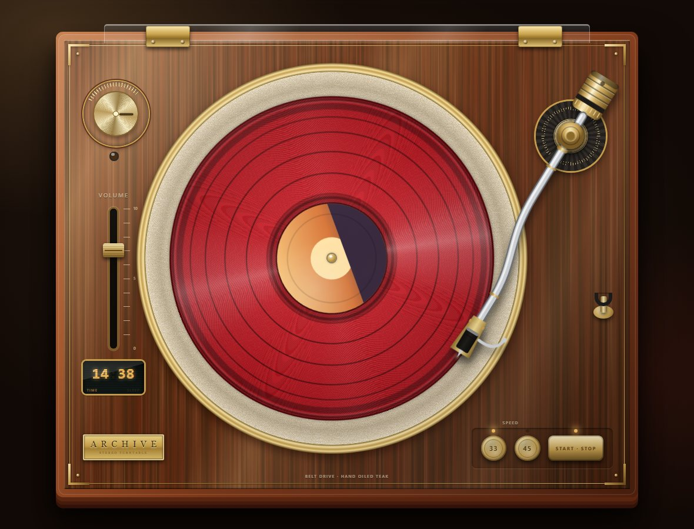
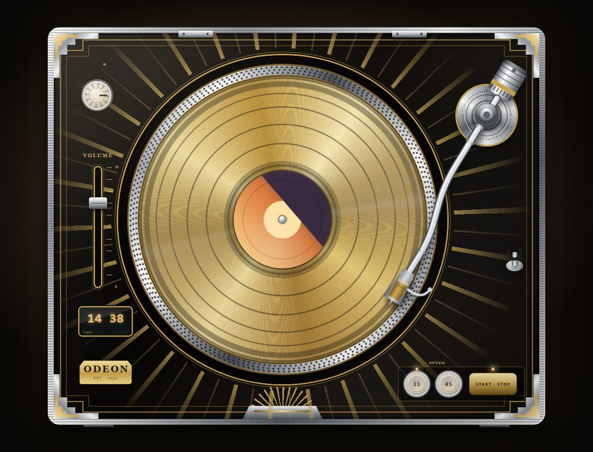
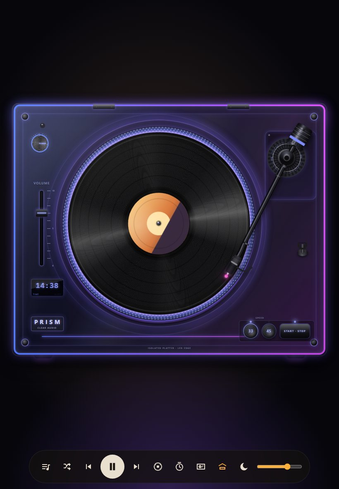

# Vinyl Deco Player

A decorative turntable for an iPad (or any browser) that plays your own Spotify music. It sits in the background like a piece of hi-fi furniture: a record spins, the tonearm moves across it as the song plays, and the label shows the album cover.

**Live:** https://prinztim.github.io/vinyl-deco-player/ (needs Spotify Premium; on an iPad use Safari, then Share → Add to Home Screen)

## What it is

I wanted something that looks like an old record player but works with my Spotify. It is a web app, not a native app: one HTML page, plain CSS and JavaScript, no build step. The music plays inside the page through Spotify's Web Playback SDK.

## Features

- **Seven turntables:** Walnut, Teak, Smoked Acrylic, Art Deco, Cream '72, DJ Deck and Marble, all drawn in CSS.
- **Nine record colours:** black, clear, white, red, gold, blue, green, splatter, picture disc and "cover colour" (takes the album art's main colour).
- **A real record swap:** when the song changes, the arm lifts, the record slides off, the next one slides on and the music starts only when the needle drops.
- **Record crate:** playlists, Liked Songs, albums, recently played and search, shown as sleeves with a record peeking out.
- **Hands-on controls:** drag the tonearm to jump inside a song, tap it to continue, drag the record off the platter with the mouse to skip, volume fader, 33/45 speed, vinyl crackle switch, sleep timer with countdown, night mode.
- **Made for a screen that stays on:** keeps the screen awake while playing, remembers your login, updates itself when a new version is published.

| Teak with a red record | Art Deco with a gold record | Smoked Acrylic on an iPad |
| --- | --- | --- |
|  |  |  |

## How it came together

- Started as a planning chat about a "music box": a turntable on an iPad that plays Spotify.
- Chose a web app on the Home Screen over a native app, and the Spotify Web Playback SDK for sound inside the page.
- Version 2 and 3 added the record swap, the crate, tonearm seeking and the display; the first skins came from concept images.
- Bugs that mattered: the next song sounding for a second before the record was on (fixed by pausing before the song ends), and the login being lost on updates (fixed with careful token refresh and a stored copy).
- A 3D tilted version was tried and dropped: the flat 2D look is easier to keep good.
- A fake Spotify player (`tools/playtest.mjs`) tests the playback and login logic without a network.

## How to run it

- **Use it:** open the live link above and log in with a Spotify Premium account.
- **Try it without Spotify:** open `index.html` with `?demo=1` (for example `index.html?demo=1&skin=teak&disc=gold`). Other previews: `?demo=sheet`, `?demo=skins`, `?demo=search`.
- **Own copy:** Spotify's login only accepts redirect addresses registered for the app. To host your own copy, create a Spotify developer app, put its Client ID and redirect URI at the top of `app.js` (`CFG`), and serve the folder from any static host. Apps in Spotify's development mode allow only a few users.
- **Tests:** `node tools/playtest.mjs` (needs Node 22 and Chrome; runs hidden).

## Tech

HTML, CSS and JavaScript without libraries or a build step. Spotify Web Playback SDK and Web API with PKCE login (no client secret). Web Audio for the crackle sound. Hosted on GitHub Pages.

## Credits

- Walnut wood texture: "Black Walnut Veneer 02" from [Poly Haven](https://polyhaven.com/a/black_walnut_veneer_02), CC0.
- Spotify is a trademark of Spotify AB. This is an unofficial hobby project and is not affiliated with Spotify.
- All other artwork (turntables, icon, records) is drawn in code. The concept pictures during design were AI-generated.
- No open-source licence has been chosen for the code yet.
